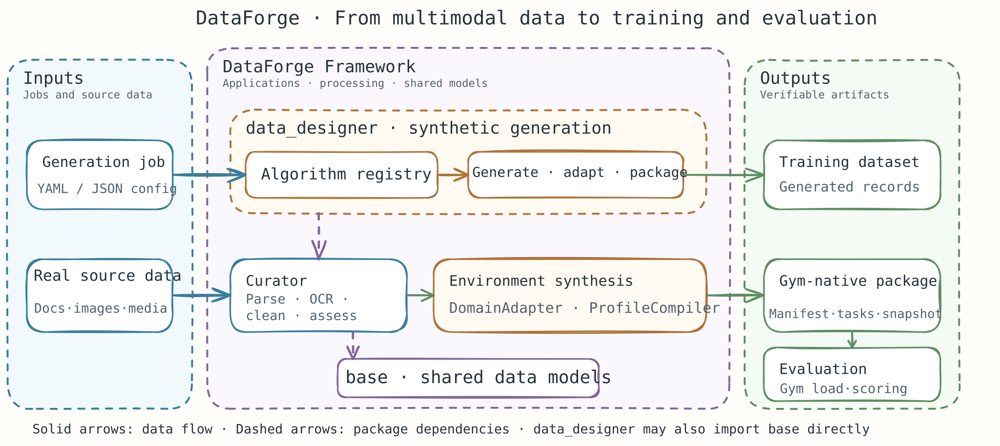

<h1 align="center">DataForge</h1>

<h3 align="center">From real multimodal data to high-quality training data and verifiable agent environments</h3>

<p align="center">
  Data curation · Synthetic data generation · Environment synthesis — one framework
</p>

<p align="center">
  
  
</p>

<p align="center">
  English | <a href="./README.zh-CN.md">中文</a>
</p>

<p align="center">
  <a href="#when-to-use">When to use</a> ·
  <a href="#overview">Overview</a> ·
  <a href="#architecture">How it works</a> ·
  <a href="#extensions">Extensions</a> ·
  <a href="#installation">Installation</a> ·
  <a href="#quick-start">Quick start</a> ·
  <a href="#capabilities">Built-in capabilities</a> ·
  <a href="#documentation">Documentation</a>
</p>

<a id="when-to-use"></a>

## 🎯 When to use DataForge

Use DataForge when your data and evaluation workflows span multiple tools and need to become reusable, reproducible, and auditable. It brings multimodal curation, synthetic data generation, and executable benchmark environments onto a shared data foundation.

| Typical scenario | What DataForge provides | Example request |
| --- | --- | --- |
| Prepare real documents and media for training | Parse, normalize, filter, augment, deduplicate, sample, and assess multimodal datasets with Curator operations. | “Parse these PDFs and images, remove low-quality records, and produce a quality report for the resulting dataset.” |
| Expand training data for rare cases | Configure a generation job, discover available algorithms, and run generation through the `dataforge` CLI. | “Generate examples for these edge cases with this job configuration and save the output package here.” |
| Turn source documents into an agent benchmark | Model a domain, compile an environment profile, and publish an immutable Gym-native environment package for loading and evaluation. | “Build a reproducible office environment benchmark from these source documents and verify that Gym can load the package.” |

<a id="overview"></a>

## ℹ️ Overview

DataForge is a Python framework for multimodal data workflows and agent environment construction. Its monorepo contains three layers:

- **`data_designer/` — applications and pipelines.** Provides the `dataforge` CLI, synthetic data generation, benchmark tooling, integrations, and vertical pipelines such as environment synthesis.
- **`curator/` — multimodal processing.** Provides datasets, operations, pipeline execution, quality assessment, checkpointing, tracking, and a Python ZMQ runtime.
- **`base/` — shared data foundation.** Supplies common data models used by the application and curation layers.

The dependency direction is enforced as `data_designer → curator → base`, with `data_designer` also allowed to use `base` directly. Curator and base remain independent of the application layer. Optional document, media, OCR, and video dependencies are loaded only for the features that need them.

<a id="architecture"></a>

## 🔄 How it works

### Architecture overview

The same shared data foundation supports two paths: preparing data for training, and turning real or modeled inputs into an executable benchmark environment.



Curator handles the reusable multimodal processing steps. The application layer composes those capabilities into generation and environment-synthesis workflows. Environment synthesis can produce a Gym-native package that is loaded by Gym and evaluated by a compatible Evaluator integration. The shared `base` package keeps common data contracts reusable while import rules preserve the one-way layer boundaries.

<a id="extensions"></a>

### Extend DataForge at the right layer

- **Generation algorithms** can be registered through the `mdp.operators` entry point, connected through an adapter, or provided as an independent service.
- **Curation operations** implement Curator's `Operation` contract and fit into its operation families and pipeline execution model.
- **Environment synthesis** can be customized with a `DomainAdapter` and `ProfileCompiler` under `data_designer/pipelines/envsynth/`.
- **Evaluation hosts** integrate through the Gym and Evaluator bridges in `integrations/`.
- **Runtime transports** are organized under `packages/`; the Python runtime is under `curator.runtime` and communicates over ZMQ.

<a id="installation"></a>

## 📦 Installation

DataForge supports Python `>=3.10`. Install the repository in editable mode from its root:

```bash
pip install -e .
```

The base install does not include heavyweight document, media, OCR, or video backends. Add only the extras required by your workflow:

| Capability | Install | Includes |
| --- | --- | --- |
| Development and tests | `pip install -e ".[dev]"` | pytest, import-linter, and development dependencies |
| Document parsing | `pip install -e ".[docs]"` | DOCX, PDF, and XLSX support |
| Image and audio | `pip install -e ".[media]"` | Pillow, OpenCV, and librosa |
| Video understanding | `pip install -e ".[video]"` | PyTorch and Transformers |
| OCR with MindOCR | `pip install -e ".[ocr-mindocr]"` | MindOCR backend |
| OCR with PaddleOCR | `pip install -e ".[ocr-paddleocr]"` | PaddleOCR backend |
| Python ZMQ runtime | `pip install -e ".[runtime]"` | pyzmq |

The development workflow also includes a TypeScript runtime. Install the JavaScript dependencies and build its packages with:

```bash
npm install
npm run build:ts
```

<a id="quick-start"></a>

## 🛠️ Quick start

### 1. Generate training data

List or inspect the registered generation algorithms, then run a job configuration. A sample job is available at [`examples/local/job.json`](examples/local/job.json).

```bash
dataforge algorithms list
dataforge algorithms describe <algorithm-id>
dataforge generate --config examples/local/job.json --output ./artifacts/job-out
```

### 2. Curate multimodal data

Install the document extra for DOCX/PDF/XLSX parsing. You can then run a document parsing example or preview the image OCR execution plan:

```bash
pip install -e ".[docs]"
python examples/curator/single_ops/loading/document_parsing_example.py
python examples/curator/single_ops/loading/image_ocr_example.py --dry-run
```

For a complete Curator pipeline example, run:

```bash
python examples/curator/usage_example.py
```

### 3. Build an environment package from real documents

The end-to-end example creates DOCX, PDF, and image inputs, parses them, synthesizes an environment, and can verify runtime loading when an AscendAgent-Gym checkout is available:

```bash
pip install -e ".[docs,ocr-paddleocr]"
python examples/envsynth_curator_e2e/run_example.py \
  --work-dir ./artifacts/envsynth-curator-e2e \
  --gym-root /path/to/AscendAgent-Gym \
  --ocr-backend paddleocr \
  --ocr-device cpu \
  --ocr-lang en
```

When Gym is not available, the example still builds and publishes the structured package; runtime verification is reported as unavailable. See the [example README](examples/envsynth_curator_e2e/README.md) for prerequisites and output details. A terminal-profile example that does not use Curator documents is available in [`examples/envsynth_terminal_e2e/`](examples/envsynth_terminal_e2e/).

### Common CLI commands

| Command | Purpose |
| --- | --- |
| `dataforge generate --config <job.json>` | Generate data from a job configuration |
| `dataforge algorithms list` / `describe <id>` | Discover and inspect generation algorithms |
| `dataforge validate <manifest>` | Validate a package or manifest |
| `dataforge benchmark build --config <config.json>` | Build a benchmark package |
| `dataforge benchmark show --catalog <path> --suite <ref@version>` | Inspect a published benchmark suite |
| `dataforge benchmark verify --package <path>` | Verify a benchmark package |
| `dataforge export gym --config <config.json>` | Export an artifact for Gym |
| `dataforge export evaluator --config <config.json>` | Export an artifact for Evaluator |

<a id="capabilities"></a>

## 🧩 Built-in capabilities

| Area | Included capabilities | Where to start |
| --- | --- | --- |
| Multimodal curation | Document and media loading, OCR, cleaning, filtering, augmentation, deduplication, sampling, quality assessment, checkpoints, and tracking | [`examples/curator/`](examples/curator/) |
| Synthetic data generation | YAML/JSON jobs, algorithm discovery, adapters, and CLI generation | [`data_designer/`](data_designer/), [`examples/local/`](examples/local/) |
| Benchmark tooling | Package validation, benchmark build/show/verify, and Gym/Evaluator export | [`data_designer/pipelines/benchmarks/`](data_designer/pipelines/benchmarks/), [`integrations/`](integrations/) |
| Environment synthesis | Domain adapters, profile compilation, immutable releases, Gym package export, and terminal/office examples | [`data_designer/pipelines/envsynth/`](data_designer/pipelines/envsynth/), [`examples/envsynth_curator_e2e/`](examples/envsynth_curator_e2e/) |
| Runtime | Python ZMQ runtime and TypeScript protocol, transport, and runtime packages | [`curator/runtime/`](curator/runtime/), [`packages/`](packages/) |

<a id="documentation"></a>

## 📖 Documentation and examples

- [Curator operations and pipeline examples](examples/curator/)
- [Environment synthesis from Curator documents](examples/envsynth_curator_e2e/README.md)
- [Terminal environment synthesis](examples/envsynth_terminal_e2e/README.md)
- [Benchmark pipeline](data_designer/pipelines/benchmarks/)
- [Environment synthesis pipeline](data_designer/pipelines/envsynth/)

## 🧪 Development

Run commands from the repository root. The architecture check enforces the package dependency direction:

```bash
pytest tests/curator -q
pytest tests/benchmarks -q
pytest tests/generation tests/integrations tests/sources tests/envsynth -q
lint-imports
npm run test:ts
```
