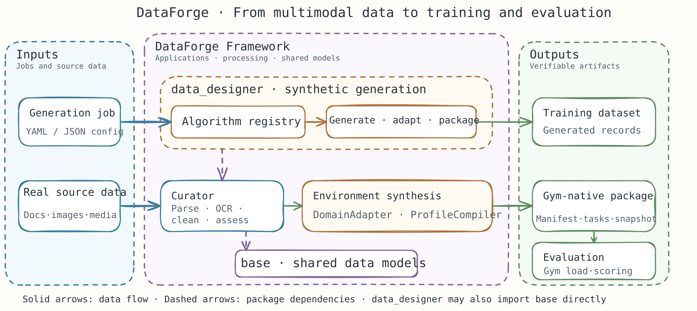

<h1 align="center">DataForge</h1>

<h3 align="center">从真实多模态数据，到高质量训练数据与可验证的智能体环境</h3>

<p align="center">
  数据治理 · 合成数据生成 · 环境合成 —— 一个框架完成
</p>

<p align="center">
  
  
</p>

<p align="center">
  <a href="./README.md">English</a> | 中文
</p>

<p align="center">
  <a href="#when-to-use">适用场景</a> ·
  <a href="#overview">项目概览</a> ·
  <a href="#architecture">工作方式</a> ·
  <a href="#extensions">扩展方式</a> ·
  <a href="#installation">安装</a> ·
  <a href="#quick-start">快速开始</a> ·
  <a href="#capabilities">内置能力</a> ·
  <a href="#documentation">文档</a>
</p>

<a id="when-to-use"></a>

## 🎯 何时使用 DataForge

当数据处理和评测流程分散在多个工具中，需要变得可复用、可复现、可审计时，可以使用 DataForge。它将多模态数据治理、合成数据生成和可执行的智能体评测环境整合到共享的数据底座上。

| 典型场景 | DataForge 提供的能力 | 示例需求 |
| --- | --- | --- |
| 为训练准备真实文档与媒体数据 | 使用 Curator 算子解析、规范化、过滤、增强、去重、抽样并评估多模态数据集质量。 | “解析这些 PDF 和图片，过滤低质量记录，并为处理后的数据集生成质量报告。” |
| 扩充长尾场景的训练数据 | 配置生成作业、发现可用算法，并通过 `dataforge` CLI 执行生成。 | “按照这份作业配置生成这些边缘场景的样本，并将结果保存到指定目录。” |
| 从源文档构建智能体 benchmark | 建立领域模型、编译环境 Profile，并发布 Gym-native 环境包，以供加载和评测。 | “根据这些源文档构建可复现的办公环境 benchmark，并验证 Gym 能否加载该环境包。” |

<a id="overview"></a>

## ℹ️ 项目概览

DataForge 是一个用于多模态数据工作流和智能体环境构建的 Python 框架。这个 monorepo 包含三个层次：

- **`data_designer/` — 应用与流水线。** 提供 `dataforge` CLI、合成数据生成、benchmark 工具、集成接口，以及环境合成等垂直流水线。
- **`curator/` — 多模态处理。** 提供数据集、算子、流水线执行、质量评估、checkpoint、tracking，以及 Python ZMQ 运行时。
- **`base/` — 共享数据底座。** 为应用层和数据治理层提供通用数据模型。

依赖方向受约束为 `data_designer → curator → base`，同时允许 `data_designer` 直接使用 `base`。Curator 和 base 均不依赖应用层。文档、媒体、OCR 和视频等可选依赖只会在需要相应能力时加载。

<a id="architecture"></a>

## 🔄 工作方式

### 架构概览

同一共享数据底座支持两类流程：准备训练数据，以及将真实输入或领域模型转化为可执行的 benchmark 环境。



Curator 负责可复用的多模态处理步骤。应用层将这些能力组合为数据生成和环境合成工作流。环境合成可以产出 Gym-native 环境包，由 Gym 加载，并通过兼容的 Evaluator 集成进行评测。共享的 `base` 包让数据契约可以复用，导入规则则维持单向的分层边界。

<a id="extensions"></a>

### 在合适的层次扩展 DataForge

- **生成算法**可以通过 `mdp.operators` entry point 注册，也可以通过适配器接入或作为独立服务提供。
- **数据治理算子**实现 Curator 的 `Operation` 契约，并归入相应的算子家族和流水线执行模型。
- **环境合成**可以在 `data_designer/pipelines/envsynth/` 下通过 `DomainAdapter` 和 `ProfileCompiler` 定制。
- **评测宿主**通过 `integrations/` 下的 Gym 和 Evaluator 桥接集成。
- **运行时传输**位于 `packages/`；Python 运行时位于 `curator.runtime`，并通过 ZMQ 通信。

<a id="installation"></a>

## 📦 安装

DataForge 支持 Python `>=3.10`。在仓库根目录以 editable 模式安装：

```bash
pip install -e .
```

基础安装不包含较重的文档、媒体、OCR 或视频后端。根据工作流需要安装对应 extras：

| 能力 | 安装命令 | 包含内容 |
| --- | --- | --- |
| 开发与测试 | `pip install -e ".[dev]"` | pytest、import-linter 和开发依赖 |
| 文档解析 | `pip install -e ".[docs]"` | DOCX、PDF 和 XLSX 支持 |
| 图像与音频 | `pip install -e ".[media]"` | Pillow、OpenCV 和 librosa |
| 视频理解 | `pip install -e ".[video]"` | PyTorch 和 Transformers |
| MindOCR | `pip install -e ".[ocr-mindocr]"` | MindOCR 后端 |
| PaddleOCR | `pip install -e ".[ocr-paddleocr]"` | PaddleOCR 后端 |
| Python ZMQ 运行时 | `pip install -e ".[runtime]"` | pyzmq |

开发工作流还包含 TypeScript 运行时。安装 JavaScript 依赖并构建相关包：

```bash
npm install
npm run build:ts
```

<a id="quick-start"></a>

## 🛠️ 快速开始

### 1. 生成训练数据

列出或查看已注册的生成算法，然后运行作业配置。示例作业配置见 [`examples/local/job.json`](examples/local/job.json)。

```bash
dataforge algorithms list
dataforge algorithms describe <algorithm-id>
dataforge generate --config examples/local/job.json --output ./artifacts/job-out
```

### 2. 治理多模态数据

解析 DOCX/PDF/XLSX 文档前，请安装文档解析 extras。随后可以运行文档解析示例，或预览图像 OCR 的执行计划：

```bash
pip install -e ".[docs]"
python examples/curator/single_ops/loading/document_parsing_example.py
python examples/curator/single_ops/loading/image_ocr_example.py --dry-run
```

运行完整的 Curator 流水线示例：

```bash
python examples/curator/usage_example.py
```

### 3. 从真实文档构建环境包

端到端示例会创建 DOCX、PDF 和图片输入，完成解析与环境合成；当可用的 AscendAgent-Gym checkout 存在时，还会验证运行时加载：

```bash
pip install -e ".[docs,ocr-paddleocr]"
python examples/envsynth_curator_e2e/run_example.py \
  --work-dir ./artifacts/envsynth-curator-e2e \
  --gym-root /path/to/AscendAgent-Gym \
  --ocr-backend paddleocr \
  --ocr-device cpu \
  --ocr-lang en
```

如果没有 Gym，示例仍会构建并发布结构化环境包，并报告运行时验证不可用。前置条件和输出说明见[示例 README](examples/envsynth_curator_e2e/README.md)。无需 Curator 文档输入的终端环境示例见 [`examples/envsynth_terminal_e2e/`](examples/envsynth_terminal_e2e/)。

### 常用 CLI 命令

| 命令 | 用途 |
| --- | --- |
| `dataforge generate --config <job.json>` | 根据作业配置生成数据 |
| `dataforge algorithms list` / `describe <id>` | 发现并查看生成算法 |
| `dataforge validate <manifest>` | 校验 package 或 manifest |
| `dataforge benchmark build --config <config.json>` | 构建 benchmark package |
| `dataforge benchmark show --catalog <path> --suite <ref@version>` | 查看已发布的 benchmark suite |
| `dataforge benchmark verify --package <path>` | 校验 benchmark package |
| `dataforge export gym --config <config.json>` | 为 Gym 导出制品 |
| `dataforge export evaluator --config <config.json>` | 为 Evaluator 导出制品 |

<a id="capabilities"></a>

## 🧩 内置能力

| 领域 | 内置能力 | 从这里开始 |
| --- | --- | --- |
| 多模态数据治理 | 文档和媒体加载、OCR、清洗、过滤、增强、去重、抽样、质量评估、checkpoint 与 tracking | [`examples/curator/`](examples/curator/) |
| 合成数据生成 | YAML/JSON 作业、算法发现、适配器和 CLI 生成 | [`data_designer/`](data_designer/)、[`examples/local/`](examples/local/) |
| Benchmark 工具 | package 校验、benchmark 构建/查看/验证，以及 Gym/Evaluator 导出 | [`data_designer/pipelines/benchmarks/`](data_designer/pipelines/benchmarks/)、[`integrations/`](integrations/) |
| 环境合成 | 领域适配器、Profile 编译、不可变发布制品、Gym package 导出，以及终端/办公环境示例 | [`data_designer/pipelines/envsynth/`](data_designer/pipelines/envsynth/)、[`examples/envsynth_curator_e2e/`](examples/envsynth_curator_e2e/) |
| 运行时 | Python ZMQ 运行时，以及 TypeScript 协议、传输和运行时包 | [`curator/runtime/`](curator/runtime/)、[`packages/`](packages/) |

<a id="documentation"></a>

## 📖 文档与示例

- [Curator 算子与流水线示例](examples/curator/)
- [基于 Curator 文档的环境合成](examples/envsynth_curator_e2e/README.md)
- [终端环境合成](examples/envsynth_terminal_e2e/README.md)
- [Benchmark 流水线](data_designer/pipelines/benchmarks/)
- [环境合成流水线](data_designer/pipelines/envsynth/)

## 🧪 开发

请在仓库根目录运行命令。架构检查会强制执行各 package 的依赖方向：

```bash
pytest tests/curator -q
pytest tests/benchmarks -q
pytest tests/generation tests/integrations tests/sources tests/envsynth -q
lint-imports
npm run test:ts
```
