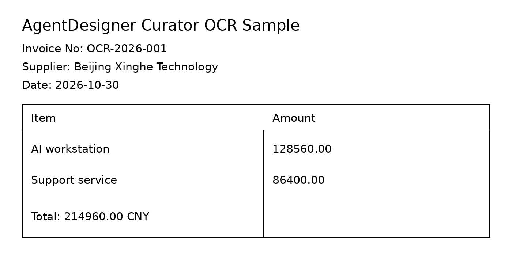

# Image OCR CPU 端到端示例

本示例使用仓库内固定图片，调用 MindOCR 的 DBNet + CRNN CPU 推理，输出 `parsed-doc-v2` JSONL。



- 输入图片：`examples/curator/single_ops/loading/assets/ocr_sample.png`
- 图片尺寸：1400 x 720
- SHA256：`d125701a1efabf7687329a5b81003218386b00f3174372398f79962c5f6e02ec`
- 输出文件：`<output-dir>/ocr-documents.jsonl`
- 完整输出：`examples/curator/single_ops/loading/assets/ocr_sample_output.jsonl`

后端效果排名与 `backend=auto` 示例见 `ocr_backend_ranking_example.md`。

## 运行命令

```bash
python examples/curator/single_ops/loading/image_ocr_example.py --image examples/curator/single_ops/loading/assets/ocr_sample.png --output-dir /tmp/image-ocr-cpu-example --backend mindocr --device cpu --lang zh --allow-model-download
```

中文/混合识别会自动下载 `ppocr_keys_v1.txt`；离线环境可改用 `--model-rec-dict /path/to/ppocr_keys_v1.txt`。官方词典会同时校验 SHA256 与行数。

## 关键输出字段

| 字段 | 值 |
|---|---|
| `doc_id` | `pd-d125701a1efabf76` |
| `schema_version` | `parsed-doc-v2` |
| `provenance.backend` | `mindocr` |
| `provenance.device` | `cpu` |
| `provenance.extractor_version` | `0.5.0` |
| `language` | `en` |
| `blocks` | `27` 个 paragraph |
| `error` | `null` |

完整 `parsed-doc-v2` 行见 `examples/curator/single_ops/loading/assets/ocr_sample_output.jsonl`，其中包含每个 block 的文本、bbox 和 `ocr_confidence`；本文不再内嵌重复 JSONL。

复现环境：WSL Linux x86_64、Python 3.10、MindOCR 0.5.0、MindSpore 2.11.0 CPU wheel、`huggingface-hub==0.24.7`、`numpy==1.26.4`。该示例不需要 NPU；识别结果只用于验证链路和输出契约，不代表生产 OCR 精度或吞吐结论。
