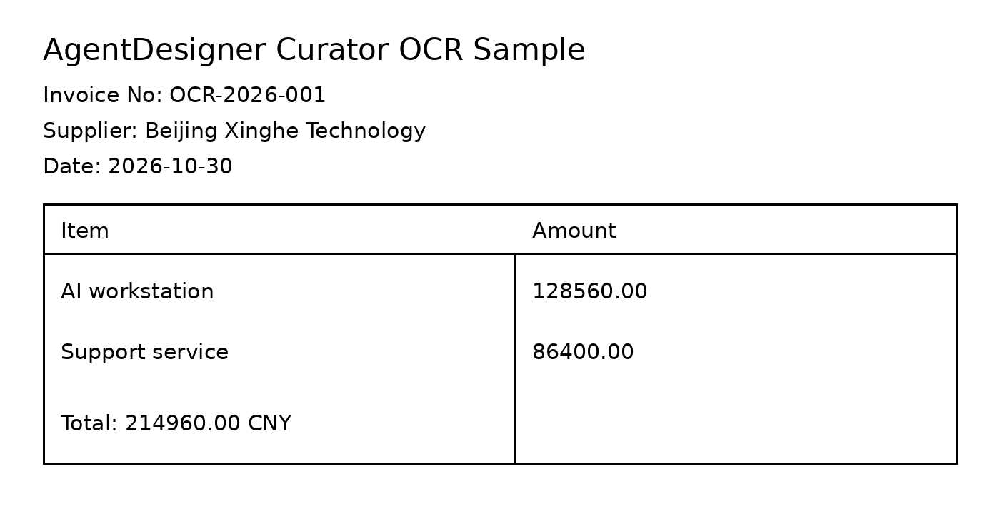

# Image OCR PaddleOCR CPU 端到端示例

本示例使用仓库内固定图片，调用 PaddleOCR 3.7.0 的官方 PP-OCRv6 medium 检测/识别模型，输出 `parsed-doc-v2` JSONL。



- 输入图片：`examples/curator/single_ops/loading/assets/ocr_sample.png`
- 图片尺寸：1400 x 720
- 输出文件：`<output-dir>/ocr-documents.jsonl`
- 完整输出：`examples/curator/single_ops/loading/assets/ocr_sample_paddleocr_output.jsonl`
- 排名模型包标识：`paddleocr-official-ppocr-default-v1`
- 固定子模型：`PP-OCRv6_medium_det` + `PP-OCRv6_medium_rec`

后端效果排名与 `backend=auto` 示例见 `ocr_backend_ranking_example.md`。

## 运行命令

```bash
python examples/curator/single_ops/loading/image_ocr_example.py --image examples/curator/single_ops/loading/assets/ocr_sample.png --output-dir /tmp/image-ocr-paddleocr-cpu-example --backend paddleocr --device cpu --lang en --allow-model-download
```

PaddleX 会把官方模型缓存到 `~/.paddlex/official_models/`（或 `PADDLE_PDX_CACHE_HOME/official_models/`）。`allow_model_download=false` 时只使用已有缓存或显式 `model_paths.det`/`model_paths.rec`，不会静默下载。PaddlePaddle 3.3.1 在本机 CPU 上需要关闭 oneDNN；运行时已设置 `enable_mkldnn=false`。

## 关键输出字段

| 字段 | 值 |
|---|---|
| `doc_id` | `pd-d125701a1efabf76` |
| `schema_version` | `parsed-doc-v2` |
| `provenance.backend` | `paddleocr` |
| `provenance.backend_version` | `3.7.0` |
| `provenance.device` | `cpu` |
| `provenance.model_id` | `paddleocr-official-ppocr-default-v1` |
| `language` | `en` |
| `blocks` | `11` 个 paragraph |
| `error` | `null` |

完整 `parsed-doc-v2` 行见 `examples/curator/single_ops/loading/assets/ocr_sample_paddleocr_output.jsonl`，其中包含每个 block 的文本、bbox 和 `ocr_confidence`；本文不再内嵌重复 JSONL。

复现环境：WSL Linux x86_64、Python 3.10、`paddleocr==3.7.0`、`paddlex==3.7.2`、`paddlepaddle==3.3.1` CPU wheel、`numpy==2.2.6`。该示例不需要 NPU；识别结果只用于验证链路和输出契约，不代表生产 OCR 精度或吞吐结论。
